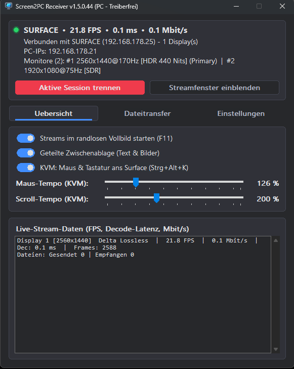
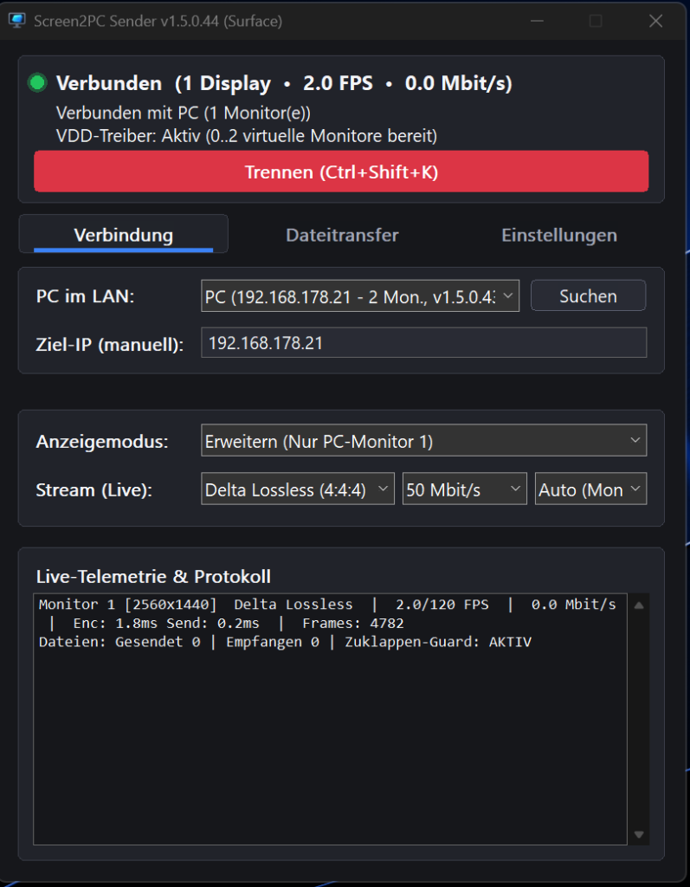
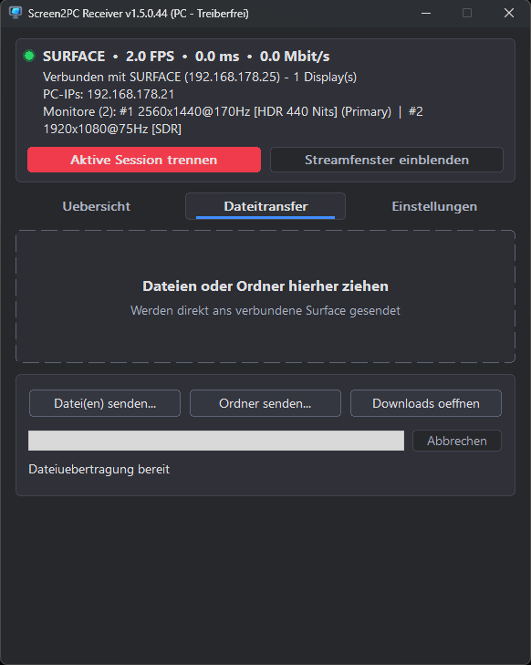
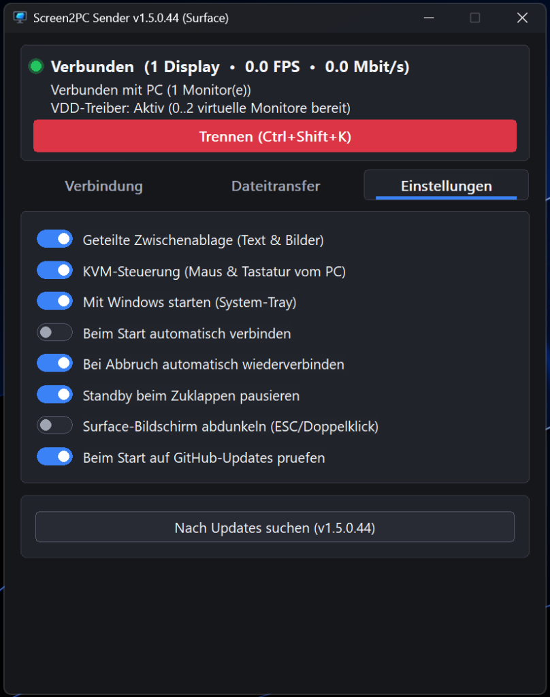
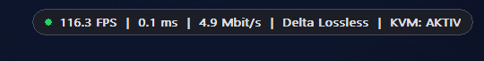
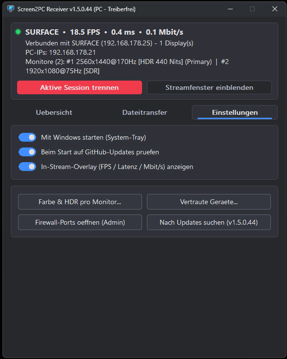

# Screen2PC

**Nutze die Monitore, das HDR-Display sowie Maus & Tastatur deines Gaming-PCs als kabellose, extrem latenzarme Erweiterung für deinen Windows-Laptop — 100 % lokal im LAN, ohne Cloud, ohne PC-Treiber.**

**Sprache:** [English](README.md) | **Deutsch**

-orange)

---

## Warum Screen2PC?

Windows *Drahtlose Anzeige / Miracast* kämpft oft mit Wi-Fi-Direct-Abbrüchen, 30/60-Hz-Limits, fehlendem Multi-Monitor-HDR und spürbarem Input-Lag. **Screen2PC** löst das direkt über dein vorhandenes Heimnetz (WLAN / Gigabit-LAN):

* **Dein Gaming-PC bleibt 100 % treiberfrei & Anti-Cheat-sicher:** `Screen2PC.Receiver.exe` läuft komplett im User-Mode. Es werden **keine** Kernel-/UMDF-Treiber, **keine** globalen Hooks (`SetWindowsHookEx`) und **kein** Test-Signing auf dem PC installiert.
* **Dein Laptop erhält 1–2 echte virtuelle Monitore (`IddCx 1.2`):** Windows erkennt die PC-Monitore (z. B. `2560×1440 @ 170 Hz HDR` + `1920×1080 @ 75 Hz SDR`) als native erweiterte Bildschirme — oder spiegelt das Laptop-Display komplett treiberfrei.
* **Ressourcensparendes reines C++20:** Kein Electron, keine .NET-Runtime, kein WebView2 (~2–5 MB RAM, Sofortstart, keine GC-Mikroruckler).

---

## Screenshots

| PC Receiver — Übersicht & Live-Telemetrie | Laptop Sender — Verbindung & Live-Qualität |
| :---: | :---: |
|  |  |

| PC Receiver — Drag & Drop Datei-/Ordner-Transfer | Laptop Sender — Energie, Zuklappen-Guard & KVM |
| :---: | :---: |
|  |  |

| Permanentes In-Stream-Quick-HUD (`FPS \| Latenz \| Mbit/s \| KVM`) | PC Receiver — Einstellungen & Overlay-Schalter |
| :---: | :---: |
|  |  |

---

## Alle Features im Überblick

* **1 bis 2 virtuelle Monitore (`IddCx 1.2`) + Live-Moduswechsel:** Erweitern auf alle PC-Monitore, nur Monitor 1, nur Monitor 2 oder Laptop-Display spiegeln — auch während laufender Verbindung umschaltbar.
* **Triple-Codec-Pipeline (live umschaltbar) + Dynamische Auto-Bitrate:**
  * **H.264 & HEVC (H.265) Low-Latency (`AMF Direct` / `QuickSync` / `NVDEC Direct`):** Direkter AMD-`amfrt64.dll`-Ultra-Low-Latency-Encoder + Zero-Copy-NV12-GPU-Shader-Decoding, 0 B-Frames, 0-Frame-DPB-Delay.
  * **Dynamische Auto-Bitrate (`Auto (Dyn.)`) & flexible Presets:** Berechnet optimale Start- und Zielgrenzen automatisch aus Auflösung, FPS, Codec-Effizienz und Multi-Monitor-Anteil und passt sich live an WLAN-Durchsatz, Encoder-Last und UDP-Paketverlust an — zusätzlich zu manuellen `15–200 Mbit/s` und `Auto / 30 / 60 / 90 / 120 FPS`.
  * **Delta Lossless (`DLT3`, RGB 4:4:4):** GPU-Compute (`cs_5_0` 64×64-Tile-Diff) + reiner C++20-**QOI**-Lossless-Hybrid + XOR/LZ4 + DXGI `MoveRects` — **100 % verlustfrei und gestochen scharf selbst beim Scrollen von Webseiten** (kein unscharfes Downscaling mehr).
* **UDP-Video + Reed-Solomon-FEC & nahtloser Stream-Auto-Reconnect:** Überträgt Frames per UDP (`48216–48217`) mit GF(2⁸)-Cauchy-RS-FEC-Parität (ohne TCP-Head-of-Line-Blocking) + automatischem TCP-Fallback und nahtlosem Stream-Reconnect ohne Schließen der Streamfenster.
* **1-Klick-Fernverbinden direkt vom PC (`Vertraute PCs`):** Starte eine Verbindung direkt am Gaming-PC — über die Laptop-Karte in der Übersicht (mit Live-Online-Status) oder mit 1 Klick aus dem PC-System-Tray. Nur vertraute PCs (`sender.ini` `[TrustedDevices]`) dürfen den Laptop wecken.
* **Echtes `scRGB`-HDR & Pro-Monitor-Farbkalibrierung:** 16-Bit-Floating-Point `scRGB` mit `DISPLAYCONFIG_SDR_WHITE_LEVEL`-Abgleich + Live-Reglern für Helligkeit, Gamma, Kontrast, Sättigung & RGB-Gain.
* **Treiberfreies 1000-Hz-KVM:** Nahtlose Maus- & Tastatursteuerung über Laptop + virtuelle Monitore per Raw Input (`WM_INPUT` + `ClipCursor`), unabhängige **KVM-Maus- & Scroll-Tempo-Regler** (`25–500 %`) und `Strg+Alt+K`.
* **In-Stream-Quick-HUD:** Kompakte D3D11-Statusleiste oben im Streamfenster mit **FPS, Decode-Latenz (ms), Bitrate (Mbit/s), Codec und KVM-Status**, Hover-Buttons (`KVM`, `Vollbild/Fenster`, `Ausblenden`) und 1-Klick-Schalter in den Einstellungen (`Strg+Alt+H`).
* **Geteilte Zwischenablage & rekursiver Ordner-Transfer:** Synchronisiert Text & Bilder (`CF_DIB`) und überträgt Dateien oder ganze Ordnerstrukturen per Drag & Drop mit **Gesamt-Fortschritt (%), übertragenen/verbleibenden MB, Speed, Abbruch & Abschlussmeldung**.
* **Laptop-Zuklappen-Schutz & Abdunkelung:** Pausiert optional das Windows-Standby beim Zuklappen (`PowrProf` + crash-sicheres INI-Restore) und dunkelt physische Laptop-Displays auf Wunsch ab (`ESC` / Doppelklick zum Reaktivieren).
* **Windows-x64-Installer, Akku-fester Autostart & 1-Klick-Auto-Updater:** Zweisprachiger Inno-Setup-Installer (`Screen2PC-Setup-x64.exe`) mit Laptop-/PC-Rollenwahl, automatischer Treiber-/Firewall-/Autostart-Einrichtung, portabler ZIP-Option und integriertem GitHub-Auto-Updater (`Auto / Deutsch / English`).

---

## Schnellstart

### Option A: Windows-Installer (Empfohlen)
1. **Download:** Lade `Screen2PC-Setup-x64.exe` aus dem [aktuellen Release](https://github.com/Aminomed/Screen2PC/releases/latest) auf **PC** und **Laptop** herunter.
2. **Auf dem Gaming-PC:** Starte den Installer und wähle die Rolle **PC (Empfänger)** — bleibt **100 % treiberfrei**, richtet die privaten LAN-Firewall-Regeln ein und aktiviert optional den Tray-Autostart.
3. **Auf dem Laptop:** Starte den Installer und wähle die Rolle **Laptop (Sender)** — installiert automatisch den UMDF-v2-Virtual-Display-Treiber `Screen2PC.Driver` (**kein Windows-Test-Signing nötig**), öffnet UDP `48218` für PC-seitiges Fernverbinden und richtet optional den akkufesten Autostart ein.
4. **Erste Kopplung:** Öffne **Screen2PC Sender** am Laptop, wähle deinen PC, klicke **Verbinden (`Ctrl+Shift+K`)** und gib die 6-stellige PIN vom PC-Bildschirm ein. Danach vertrauen sich beide Geräte dauerhaft — künftige Verbindungen klappen automatisch vom **Laptop** oder per **1-Klick direkt vom PC / PC-Tray**.

### Option B: Portables ZIP
* Lade `Screen2PC-Windows-x64.zip` aus dem [aktuellen Release](https://github.com/Aminomed/Screen2PC/releases/latest) herunter und entpacke das Archiv auf beiden Geräten.
* Auf dem **Gaming-PC** starte `Screen2PC.Receiver.exe` (keine Installation nötig; optional unter Einstellungen **Firewall-Ports öffnen (Admin)** klicken).
* Auf dem **Laptop** führe einmalig `scripts\install_driver.ps1` als Admin aus (für erweiterte virtuelle Monitore) und starte dann `Screen2PC.Sender.exe`.

> **Hinweis zu Windows SmartScreen:** Da Screen2PC ein unabhängiges Open-Source-Projekt ohne teures EV-Code-Signing-Zertifikat ist, kann beim ersten Start eine SmartScreen-Warnung erscheinen (*„Weitere Informationen → Trotzdem ausführen“*). Alternativ lässt sich alles jederzeit direkt aus dem Quellcode über Visual Studio 2022 / GitHub Actions selbst bauen.

---

## Sicherheit & Datenschutz

* **100 % lokales Netz:** Bilddaten, KVM-Eingaben, Zwischenablage und Dateien verlassen niemals dein lokales LAN/WLAN. Die einzige optionale Internet-Anfrage ist die Update-Prüfung gegen GitHub Releases (in den Einstellungen abschaltbar).
* **Kryptographische 6-stellige PIN + gegenseitige Vertrauenslisten:** Unbekannte Sender müssen eine per `BCryptGenRandom` erzeugte PIN eingeben (`Pairing.cpp`, Constant-Time-Prüfung). Eine laufende Session wird erst nach bestandener Authentifizierung abgelöst. Fernverbindungs-Trigger vom PC (UDP `48218`) werden strikt gegen die `TrustedDevices`-Liste des Laptops geprüft und lassen sich jederzeit in den Einstellungen deaktivieren.
* **Path-Traversal-Schutz:** Alle relativen Dateipfade werden bereinigt (`SanitizeRelativePath`), `..` / UNC / Laufwerkspfade werden blockiert; Downloads landen ausschließlich in `%USERPROFILE%\Downloads\Screen2PC`.
* **Saubere Deinstallation:** Über Windows **Apps & Features** (bei Nutzung von `Screen2PC-Setup-x64.exe`) oder per `scripts\uninstall_driver.ps1` (Admin) am Laptop restlos entfernbar.

---

<strong>Under the Hood — Architektur & Low-Latency-Technik (Geek-Deep-Dive)</strong>

### Stack & Ressourcenbedarf
* **Sprache:** Reines **C++20** (`stdcpp20`, `x64`, `/MT` Static-CRT, Visual Studio 2022 `v143`) — null Drittanbieter-Runtimes.
* **APIs:** Win32 (`Per-Monitor DPI v2`, `Common Controls v6`), D3D11 + Compute-Shader (`cs_5_0`), DXGI 1.6 (`IDXGIOutput6`, `ALLOW_TEARING`, Waitable SwapChain), Direct AMD AMF (`amfrt64.dll`), Media Foundation, Winsock2, `IPHelper`, `BCrypt`, `PowrProf`, WinHTTP, UMDF v2 (`IddCx 1.2`).

### Netzwerk-Ports (`src/common/Protocol.h` — Protokoll `v3`)
| Port | Protokoll | Zweck |
| :--- | :--- | :--- |
| `48210` | UDP | LAN-Discovery (`DiscoverReq` / `DiscoverResp` / `VersionMismatch`) |
| `48211` | TCP | Control-Kanal (Auth, `ReconfigureStream`, `ClipboardSync`, zuverlässiger KVM-Fallback, Heartbeat) |
| `48212–48213` | TCP | Videostream pro Monitor + Cursor-Shapes + Groß-Frame-Fallback (`> 256 KB`, `64 KB`/`128 KB`-Puffer) |
| `48214` | TCP | Dedizierter rekursiver Datei-/Ordner-Transfer (`64 KB`-Chunks, CRC32-geprüft) |
| `48215` | UDP | **Realtime-KVM- & Cursor-Kanal** (`THREAD_PRIORITY_HIGHEST`, `kMouseMove` UDP-only, Tasten/Scroll per Dual UDP+TCP dedupliziert) |
| `48216–48217` | UDP | **Video + GF(2⁸)-Cauchy-RS-FEC-Kanal** (`1360 B`-Shards, repariert WLAN-Paketverluste ohne TCP-Head-of-Line-Blocking) |
| `48218` | UDP | **PC-seitiges Fernverbinden & Online-Probe** (geprüft gegen Laptop-`[TrustedDevices]` + `AllowRemoteConnect`) |

### Low-Latency-Techniken
1. **Sub-Millisekunden-Maus (`WM_INPUT` + UDP):** Rohe HID-Mausdeltas werden ohne Timer-Batching sofort (`<= 1 ms` / 1000 Hz) über UDP `48215` gesendet, inkl. Sub-Pixel-Akkumulatoren (`KvmInput`).
2. **Direct AMD AMF (`amfrt64.dll`) + Dynamische Auto-Bitrate:** Lädt `amfrt64.dll` direkt per C-ABI (`AMFVideoEncoderVCE_AVC` / `AMFVideoEncoderHW_HEVC`) mit `ULTRA_LOW_LATENCY`, 0 B-Frames, 3-Slot-`AllocSurface`-Ring und dynamischer Echtzeit-Bitratenregelung anhand von Sendezeit, Encoder-Last und UDP-Paketverlusten.
3. **Waitable `FLIP_DISCARD` + `ALLOW_TEARING`:** `D3D11Renderer` nutzt eine `MsgWaitForMultipleObjectsEx`-Schleife direkt auf `DXGI_SWAP_CHAIN_FLAG_FRAME_LATENCY_WAITABLE_OBJECT` (MaxFrameLatency `1`), entkoppelt vom `recvDecodeThread`.
4. **Zero-Copy DXVA `NV12` → `scRGB` Shader:** Dekodierte H.264-/HEVC-`NV12`-Surfaces werden direkt auf der GPU kopiert (`CopySubresourceRegion`) und in `PSMainNv12` (BT.709 Studio → `scRGB` HDR/SDR) gewandelt — ohne `VideoProcessorBlt`.
5. **GPU-Compute-Delta + `DLT3`-QOI-Hybrid:** Ein `cs_5_0`-Compute-Shader vergleicht `64×64`-Tiles direkt auf der GPU (null Pixel-Readback bei Stillstand), komprimiert große Änderungen verlustfrei per pure-C++20-QOI sowie kleine UI-Diffs per XOR+LZ4 + `MoveRects` und lädt nur die geänderte Bounding-Box (`D3D11_BOX`) hoch — Text bleibt selbst beim Scrollen 100 % gestochen scharf.
6. **In-Stream Quick-HUD:** Als gecachte premultiplied GDI-DIB → D3D11-Textur direkt in `D3D11Renderer::Present()` gerendert, sodass DWM im Hardware-Independent-Flip (`ALLOW_TEARING`) bleibt.

---

## Selbst kompilieren

* **Voraussetzungen:** Visual Studio 2022 (`v143` C++20), Windows 11 SDK + WDK NuGet (`10.0.26100.2454` über `packages.config`).
* `Screen2PC.sln` öffnen, NuGet-Pakete wiederherstellen und **`Release | x64`** bauen.
* `out\Release\x64\Screen2PC.Tests.exe` führt die automatisierten Unit- & Integrationstests aus.

---

## Lizenz

Veröffentlicht unter der [MIT-Lizenz](LICENSE).
