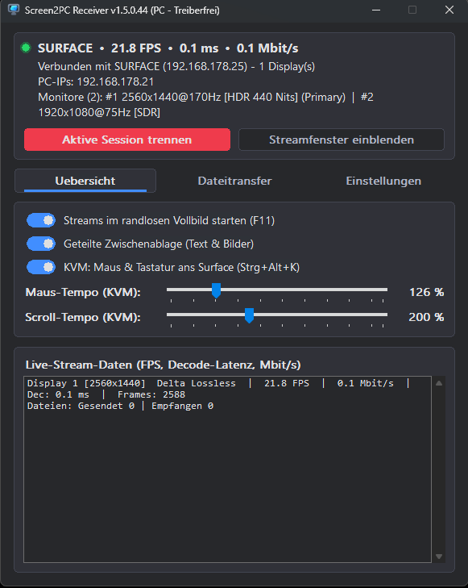
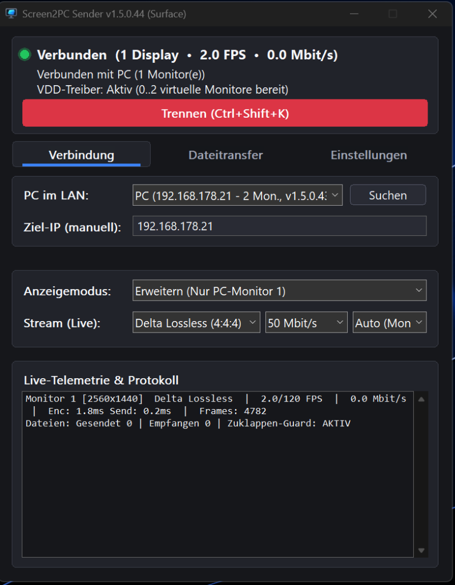
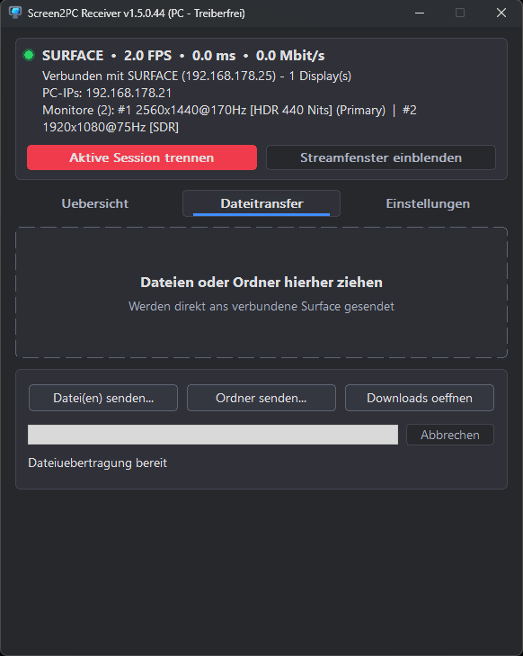
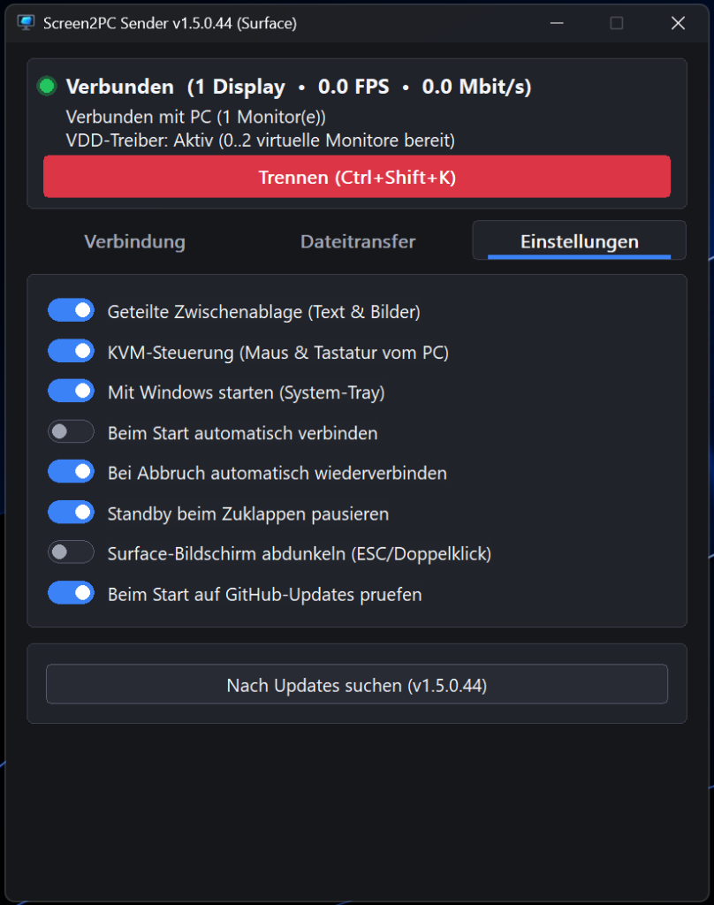
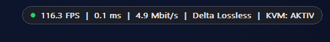
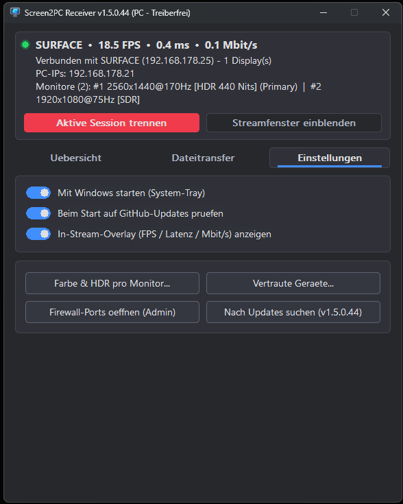

# Screen2PC

**Turn your Gaming PC's monitors, HDR display, mouse & keyboard into an ultra-low-latency wireless extension for your Windows Laptop — 100% local LAN, zero cloud, zero PC drivers.**

**Language:** **English** | [Deutsch](README.de.md)

-orange)

---

## Why Screen2PC?

Windows *Wireless Display / Miracast* often suffers from Wi-Fi Direct connection drops, 30/60 Hz caps, no multi-monitor HDR support, and noticeable input lag. **Screen2PC** solves this over your existing local network (Wi-Fi / Gigabit LAN):

* **Your PC stays 100% driver-free & anti-cheat safe:** `Screen2PC.Receiver.exe` runs purely in User-Mode. It installs **zero** kernel/UMDF drivers, **zero** global hooks (`SetWindowsHookEx`), and requires **no** Windows Test-Signing.
* **Your Laptop gets 1–2 real virtual monitors (`IddCx 1.2`):** Windows sees your PC's monitors (e.g. `2560×1440 @ 170 Hz HDR` + `1920×1080 @ 75 Hz SDR`) as native extended displays — or mirrors your Laptop screen driver-free.
* **Featherweight Pure C++20:** No Electron, no .NET runtime, no WebView2 (~2–5 MB RAM, instant startup, zero GC micro-stutters).

---

## Screenshots

| PC Receiver — Overview & Live Telemetry | Laptop Sender — Connection & Live Quality |
| :---: | :---: |
|  |  |

| PC Receiver — Drag & Drop File/Folder Transfer | Laptop Sender — Power, Lid-Close & KVM Settings |
| :---: | :---: |
|  |  |

| Always-On In-Stream Quick-HUD (`FPS \| Latency \| Mbps \| KVM`) | PC Receiver — Settings & In-Stream HUD Toggle |
| :---: | :---: |
|  |  |

---

## Key Features

* **1 to 2 Virtual Displays (`IddCx 1.2`) + Live Mode Switching:** Extend onto all PC monitors, Monitor 1 only, Monitor 2 only, or Mirror Laptop screen — switchable on the fly while connected.
* **Dual-Codec Pipeline (Live-Switchable):**
  * **H.264 Low-Latency (`AMF ULL` / `QuickSync` / `NVDEC Direct`):** Constrained Baseline, 0 B-frames, 0-frame DPB reorder delay, and dynamic ABR bitrate backoff (`15–200 Mbps`, `Auto / 60 / 90 / 120 FPS`).
  * **Delta Lossless (`DLT2`, RGB 4:4:4):** Fast XOR + LZ4 + DXGI `MoveRects` with automatic **100% lossless settle** after `120 ms` of stillness for razor-sharp text.
* **True `scRGB` HDR & Per-Monitor Color Calibration:** 16-bit floating-point `scRGB` output with `DISPLAYCONFIG_SDR_WHITE_LEVEL` matching + live Brightness / Gamma / Contrast / Saturation / RGB Gain sliders.
* **Driver-Free 1000 Hz Full-Desktop KVM:** Seamless mouse & keyboard control across all Laptop + virtual monitors using Raw Input (`WM_INPUT` + `ClipCursor`), independent **KVM Mouse & Scroll Speed** sliders (`25–500%`), and `Ctrl+Alt+K` toggle.
* **Always-On In-Stream Quick-HUD:** Compact D3D11 overlay at the top of the stream window showing live **FPS, Decode Latency (ms), Bitrate (Mbps), Codec, and KVM status**, with hover action buttons (`KVM`, `Fullscreen/Window`, `Hide`) and a 1-click toggle in Settings (`Ctrl+Alt+H`).
* **Bidirectional Clipboard & Recursive Folder/File Transfer:** Syncs text & images (`CF_DIB`), and sends files or entire nested folders via Drag & Drop with **overall batch percentage, transferred/remaining MB, speed, Cancel, and completion alert**.
* **Laptop Lid-Close Guard & Screen Dimming:** Optionally pauses Windows sleep on lid close (`PowrProf` + crash-safe INI restore) and blacks out physical Laptop screens (`ESC` / double-click to wake) while connected.
* **1-Click GitHub Auto-Updater & Bilingual UI:** Checks GitHub Releases automatically, updates binaries atomically, and supports **Auto / Deutsch / English** live in Settings.

---

## Quickstart

1. **Download:** Grab `Screen2PC-Windows-x64.zip` from the [Latest Release](https://github.com/Aminomed/Screen2PC/releases/latest) and extract it on both your **PC** and **Laptop**.
2. **On your Gaming PC (Receiver — Zero Install):**
   * Run `Screen2PC.Receiver.exe`.
   * *(Optional)* Click **Open Firewall Ports (Admin)** in Settings once so UDP `48210, 48215` and TCP `48211–48215` are allowed on your private LAN.
3. **On your Laptop (Sender):**
   * *(One-time for Extended Monitors)* Right-click `scripts\install_driver.ps1` → **Run with PowerShell** (Admin). This installs the `Screen2PC.Driver` UMDF v2 virtual display driver with a local self-signed `.cat` certificate (**no Test-Signing required**).
   * Run `Screen2PC.Sender.exe`, select your PC from **PC on LAN**, and click **Connect (`Ctrl+Shift+K`)**.
4. **First-Time Pairing:** Enter the 6-digit PIN shown on your PC into the Laptop prompt. Once trusted, future connections are automatic.

> **Note on Windows SmartScreen:** Because Screen2PC is an independent open-source project without an expensive EV code-signing certificate, Windows SmartScreen may show *"Windows protected your PC"* on first launch. Click **More info → Run anyway**, or build directly from source using Visual Studio 2022 / GitHub Actions.

---

## Security & Privacy

* **100% Local Network Only:** Video, audio-free desktop frames, KVM input, clipboard, and files travel exclusively between your Laptop and PC on your LAN. The only optional outbound request is the GitHub Releases API check for updates (can be disabled in Settings).
* **Cryptographic 6-Digit PIN + MAC Trust:** Unknown senders are challenged with a `BCryptGenRandom` 6-digit PIN (`Pairing.cpp`, constant-time verification). An active session is never replaced until protocol version and PIN/MAC trust succeed.
* **Path-Traversal Protection:** File/folder transfers sanitize all relative paths (`SanitizeRelativePath`), block `..` / UNC / drive-letter escapes, and write only inside `%USERPROFILE%\Downloads\Screen2PC`.
* **Clean Uninstall:** Run `scripts\uninstall_driver.ps1` (Admin) on your Laptop to remove the virtual display driver cleanly.

---

<strong>Under the Hood — Architecture & Low-Latency Pipeline (Geeky Deep-Dive)</strong>

### Stack & Footprint
* **Language:** Pure **C++20** (`stdcpp20`, `x64`, `/MT` static CRT, Visual Studio 2022 `v143`) — zero external runtime dependencies.
* **APIs:** Win32 (`Per-Monitor DPI v2`, `Common Controls v6`), D3D11, DXGI 1.6 (`IDXGIOutput6`, `ALLOW_TEARING`, Waitable SwapChain), Media Foundation, Winsock2, `IPHelper`, `BCrypt`, `PowrProf`, WinHTTP, UMDF v2 (`IddCx 1.2`).

### Network Ports (`src/common/Protocol.h`)
| Port | Protocol | Purpose |
| :--- | :--- | :--- |
| `48210` | UDP | LAN Discovery (`DiscoverReq` / `DiscoverResp` / `VersionMismatch`) |
| `48211` | TCP | Control Channel (Auth, `ReconfigureStream`, `ClipboardSync`, Reliable KVM fallback, Heartbeat) |
| `48212–48213` | TCP | Per-monitor video stream + cursor shape updates (asymmetric socket buffers: `256K/64K` Sender, `64K/512K` Receiver) |
| `48214` | TCP | Dedicated recursive folder/file transfer (`64 KB` chunks, CRC32 verified) |
| `48215` | UDP | **Realtime KVM & Cursor Channel** (`THREAD_PRIORITY_HIGHEST`, `kMouseMove` UDP-only, buttons/wheel deduplicated dual UDP+TCP) |

### Low-Latency Engineering
1. **Sub-Millisecond Mouse (`WM_INPUT` + UDP):** Raw HID mouse deltas flush immediately (`<= 1 ms` / 1000 Hz) over UDP port `48215` with sub-pixel speed accumulators (`KvmInput`).
2. **Waitable `FLIP_DISCARD` + `ALLOW_TEARING`:** `D3D11Renderer` runs a `MsgWaitForMultipleObjectsEx` loop synchronized directly to `DXGI_SWAP_CHAIN_FLAG_FRAME_LATENCY_WAITABLE_OBJECT` (MaxFrameLatency `1`), decoupled from the `recvDecodeThread`.
3. **Zero-Copy DXVA `NV12` → `scRGB` Shader:** Decoded H.264 `NV12` surfaces are copied directly on the GPU (`CopySubresourceRegion`) and converted in `PSMainNv12` (BT.709 Studio → `scRGB` HDR or SDR) — skipping `VideoProcessorBlt`.
4. **Latest-Frame-Wins Async Sender Queue:** `SenderEngine` encodes with 4-slot GPU NV12 conversion ring and drops stale queued frames before TCP send (auto-forcing an IDR keyframe if an H.264 delta was skipped).
5. **In-Stream Quick-HUD:** Rendered as a cached premultiplied GDI-DIB → D3D11 texture quad inside `D3D11Renderer::Present()` so DWM stays in hardware Independent Flip (`ALLOW_TEARING`) with zero popup composition penalty.

---

## Building from Source

* **Requirements:** Visual Studio 2022 (`v143` C++20), Windows 11 SDK + WDK NuGet (`10.0.26100.2454` via `packages.config`).
* Open `Screen2PC.sln`, restore NuGet packages, and build **`Release | x64`**.
* Run `out\Release\x64\Screen2PC.Tests.exe` to execute the automated unit & integration test suite.

---

## License

Licensed under the [MIT License](LICENSE).
